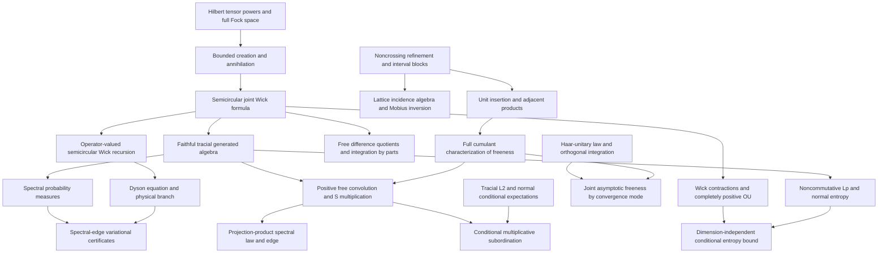

# Mathematical target audit and dependencies

Targets are the concrete theorems in [PROJECT_GOAL.md](PROJECT_GOAL.md). This audit
compares actual existing declarations with those targets. Open entries are
obligations, not assumptions that count as established results.

See [EXECUTION_QUEUE.md](EXECUTION_QUEUE.md) for current isolated worker
assignments, verification checkpoints, design decisions and successive tasks.

## Audit of the eleven goals

| Goal | Existing reusable results | Earliest missing dependencies and remaining target |
| --- | --- | --- |
| 1. Cumulant calculus — complete | All-order freeness iff mixed cumulants vanish; inversion, multilinearity/naturality; unit/scalar/centering and adjacent/interval-product calculus; actual refinement lattice and Möbius inversion; pairings, Catalan counts and interval blocks; greatest Kreweras complement, exact block counts/raw connectivity; actual alternating moments and boxed product cumulants | Certified after PR #1 merge and full main checks at `76af384`. Rotation/closed-form μ are optional; analytic S multiplication belongs to Goal 7 |
| 2. Fock semicircular systems — complete | Complete full F(H) for arbitrary complete complex H and arbitrary ON family without spanning/countability assumptions; original-H literal completed tensor creation/adjoints, scalar vacuum and grading; canonical relations and self-adjoint/centered/variance-one/norm-two fields; actual faithful tracial literal generated C-star state, freeness and joint Wick/Catalan; explicit semicircle density and exact operator spectrum | Certified after PR #5 and full main checks at `68de4fe`. Independently chosen-model unitary coherence integrated at `4c9b9f2` |
| 3. Free integration by parts — complete | All-degree actual word IBP; polynomial/joint-distribution interfaces | Actual tensor polynomial derivative with full Leibniz, polynomial and finite-matrix IBP are integrated. Actual single-generator resolvent IBP and Cauchy quadratic on the full resolvent set integrated; entire scalar/finite-matrix polynomial exponential IBP is integrated at `9715c11`; full polynomial/matrix resolvent IBP on every actual invertibility point and restricted-state transport are integrated at `287bcf7`; full norm-convergent scalar/matrix/closed-state series are integrated at checked main `5706254` with explicit value and derivative bounds and a genuine infinite-series usage; Goal 3 is certified |
| 4. Operator-valued Dyson | Actual matrix conditional expectation, all amplified covariance positivity and scalar-state complete positivity; actual Fock matrix model, ordered joint/interspersed Wick law, tensor FDQ and covariance moment recursion, checked at `a1f942b` | Actual full-domain affine matrix inverse Dyson is integrated at `e7f693e`. Actual strict half-plane sign, normalized analytic physical branch, full right-exterior positivity, derivative and Lyapunov are integrated at `3f6b367`. General arbitrary-base CP-covariance realization and entrywise comparison remain |
| 5. Spectral-edge formula | Actual affine Hermitian matrix pencil, full right spectral-exterior positivity and actual derivative/Lyapunov integrated at `3f6b367`; actual completion-square and exact top-edge variational formula integrated at `06f8254` | Positive-state/density inequalities integrated at `5131911` and actual full-exterior spectral gap order bounds at `95c414c`; quantitative finite Fock truncation bounds, singular edge limits and deterministic edge subspaces remain. General Hermitian coefficients require neither positivity nor commutation |
| 6. Spectral distributions — complete | Actual compact spectral probability measures; real/complex continuous CFC integral representation; faithful support=spectrum; whole-resolvent Cauchy spectral integral; algebraic power/polynomial compatibility and equality iff power moments; bounded moment convergence gives actual weak laws and every pointwise nonreal Cauchy limit; existing moment/local inverse/S-germ APIs | Certified after PR #2 and full main checks at `427f72b`. Norm boundedness is explicit; uniform or derivative convergence is not claimed. S multiplication remains Goal 7 |
| 7. Multiplicative convolution — complete | `sTransform_idempotent_eventually`, `sTransform_zero`, transform scaling and naturality; rational projection-product parameter calculus | Actual projection two-atom measure and matching real-trace S germ integrated at `8d38c42`. Generic closure freeness and actual near-zero inverse membership integrated at `714c2de`, quantitative centered bounds at `1767b48`; actual analytic S multiplication, positive sandwich law and cross-realization marginal-law determination integrated at `c292997`. General arbitrary grouping and continuous closed grouping integrated at `3b5fa1d`; actual finite positive-product and half-projection germs/law uniqueness integrated at `149ec02`; actual local moment equation and positive moment/support criterion integrated at `5920b0a`; positive Picard coefficient convergence integrated at `ba2ea90`; actual analytic Picard/moment germ matching integrated at `6087183`; actual Taylor/radius transfer, sharp greatest law-support point and full physical exterior branch, critical-support connection and faithful actual spectral edge certified after PR38 at checked main `bdd05e2`. Universal realization remains Goal11 |
| 8. Conditional subordination | Algebraic conditional expectations and explicit nonzero-mean inverse-transform domain | Tracial noncommutative L² and von Neumann conditional expectation; analytic multiplicative subordination, exterior continuation, enlarged conditioning and annihilating-projection specialization |
| 9. Haar freeness | Orthogonal Haar probability/invariance, low-order moments, spherical/Gaussian laws, concentration and almost-sure array convergence; algebraic joint moments | Abstract Haar-unitary star-law and free conjugation; general orthogonal pairing integration and joint asymptotic estimates. Separate expected, probability, almost-sure and strong convergence interfaces |
| 10. Free Gaussian OU/entropy | General positive expectations; actual polynomial Wick vacuum vectors with `Fock.vacuumExpectation_wick_star_mul` orthogonality | Actual reverse-overlap Wick multiplication and general homogeneous Haagerup bound integrated at `be0f163`; actual unitary second quantization integrated at `cfcc7a5`; genuine cross-space isometry and all-level CP compression integrated at `741660d`; doubled rotation and actual Wick scaling integrated at `8231e13`, generated-algebra range/embedding and genuine native CP self-map/Wick action and full norm-closure semigroup integrated at `d5c9801`; true state L2 contraction and genuine complete cyclic Hilbert extension integrated at `03aff10`; strong action continuity on native algebra/complete cyclic L2 integrated at `2470d2a`; actual ambient WOT compression/conjugation integrated at `619788f`; actual WOT-generated reducing/range/faithfulness/injectivity integrated at `ab1573b`; normal embedding/OU extension; noncommutative Lᵖ, entropy, data processing, lower semicontinuity and dimension-independent regularization |
| 11. Follow-up foundations | Scalar and algebraic operator-valued probability, cumulants, analytic transform tools | Formal R-additivity and algebraic moment free CLT integrated; concrete variance-one faithful tracial Fock target integrated. Quantitative non-iid moment CLT integrated under explicit cumulant bounds and averaged variance convergence. Positive free products, analytic additive convolution/R identification, operator-valued cumulants, second-order/annular theory and genus expansions remain |

Goals 1, 2, 3, 6 and 7 are certified complete at checked main `76af384`, `68de4fe`,
`5706254`, `427f72b` and `bdd05e2`; the other six targets remain open. Supporting interfaces alone do not certify a target. See
[PROGRESS.md](../PROGRESS.md) for verified declarations and their current scope.

## First development path

Refinement and interval-block combinatorics support noncrossing deletion,
contraction and insertion maps. Those maps support unit insertion and
adjacent-product cumulant identities, then the missing direction of the freeness
characterization. Finite lattice structure and its incidence algebra are needed
for the separate Möbius-inversion goal; recursive inversion is already available
and should not be replaced.

Full Fock space is a separate first-priority path. Establish its Hilbert-space
model and bounded creation operators before claiming semicircular moments,
faithfulness or traciality. The vacuum state on all bounded Fock operators is not
a substitute for its faithful tracial restriction to the semicircular algebra.

[Sources and attribution](SOURCES.md) records dependency provenance. Existing
matrix and ReLU modules are examples and reusable tools, not application targets.

### Actual sharp projection-product law edge integration feature

Checked main `73ce833` includes CI Verification coverage (full3745,
Verification3748, direct transitive audit5008 and source guard).
Seven reviewed analytic modules through `3d8a9d9`, with frozen notes `37b2f94`,
are assembled for integration. Actual expectation Taylor coefficients transfer
from the constructed Picard germ, giving true moment summability and support
bounds. Critical scalar supersolutions prove the sharp upper bound for ALL L>=2.
Analytic continuation of the true LAW moment series, its positivity and the
GLOBAL scalar curve maximum prohibit any smaller support bound. Consequently
`StarProbabilitySpace.iteratedHalfProjection_law_support_isGreatest` proves
lambda_L belongs to the actual support and is its greatest point; the right-edge
corollary identifies its supremum. No faithfulness assumption is needed for the
law edge. An actual three-projection usage gives greatest support point 27/32.
`iteratedHalfProjection_realCauchyTransform_eq_momentSum` identifies the actual
law Cauchy integral throughout x>lambda_L, without an ambient resolvent premise.
The separately reviewed physical branch chain through `401d9ff` and notes
`b3a58a5` is published but not yet integrated; Goal7 remains open at this feature.
A owns NEW PhysicalLimits/PhysicalSpectrum modules in its isolated worktree.
B owns NEW SecondQuantizationSuffix modules, with all12 prefix/identification
sources frozen at `0cb842d` pending integration. Reviewer is read-only.
Next independent tasks: integrate the physical branch and faithful spectrum
corollaries; integrate prefix/sector/ALLoperator identification; develop suffix
commutants toward the normal OU extension. No normality claim follows from
bounded-WOT continuity alone; unbounded amplification continuity is false.

Feature checks pass: full lake build3752, Verification3755, direct transitive
axiom audit5089 declarations, source guard/diff. Concrete 27/32 usage compiles.
Its first compilation required qualifying MeasureTheory.Measure; this was a
usage namespace error, not a failure of any mathematical source.
GitHub CI confirmed PR34 run38571454427, PR35 run38572925297 and
PR36 run38573679338 success. Physical and prefix chains critically reviewed
at final published tips; their separate integrations remain queued.

### Actual physical projection branch and faithful spectral edge feature

PR37 sharp actual-law edge merged as `272452cd7a53169da0d30f9bc236fd5b4ad92b14`;
checked main full3752, Verification3755, direct audit5089, integrity/diff and push.
Reviewed physical core through `401d9ff` and frozen notes `b3a58a5` are assembled.
The actual law parameter W=xG(x)-1 is positive throughout x>lambda_L, satisfies
z_L(W)=x, and lies in the proved physical domain. It is the unique root there;
every physical parameter is realized, and the curve image is exactly (lambda_L,infinity).
For L=2 the domain is all positive W; for L>=3 it is 0<W<1/(L-2).
Reviewed `6be9139` identifies the genuine stationary curve value with the actual
support maximum. `aa3739d` proves actual W→0 and xG→1 at infinity.
`7c17f68` proves the L2 curve tends to1 at infinite parameter and the ACTUAL
W(x) tends to infinity as x decreases to1; no finite L2 critical coordinate.
Spectrum wrappers `e75218e` identify the actual ambient spectral maximum under
faithfulness and supply the full sharp exterior operator resolvent; operator and
law Cauchy transforms agree at every actual resolvent point without faithfulness.
The faithful exterior normalized operator parameter is the actual physical W.
Goal7 completion audit is pending the reviewer certificate and integration checks.
Other open targets retain their exact scope; normal OU, entropy and general
operator-valued covariance/subordination/asymptotic foundations remain open.

Physical feature checks pass: full3762, Verification3765, direct transitive audit
5159 declarations, source integrity/diff. Actual length-two unique-root usage
compiles. Reviewer approves all ten physical modules including exact faithful
spectrum scope, and certifies that every literal Goal7 mathematical subtarget
is covered after successful main integration. Convolution is for GIVEN free
positive elements with proved cross-realization law independence; universal
free-product realization remains the independent Goal11 obligation.
Certificate must be recorded only after the merged main checkpoint passes.
A clean isolated worktree now uses `feat/haar-conjugation`, based on checked
main272452c, owning only NEW HaarUnitary/HaarConjugationWords/HaarConjugation
and agreed notes. Next target is entire-algebra integer Haar conjugate freeness.
B continues new suffix amplification/commutant work; frozen prefix integration next.

### Goal7 completion certificate at checked main bdd05e2

Physical branch PR38 merged as `bdd05e233dcac523f886247b984a2680cbf76327`.
Post-merge full lake build3762, Verification3765, direct transitive audit5159,
source integrity/diff and explicit main push pass. PR37 supplies actual law edge.
The read-only reviewer checked every literal Goal7 requirement in PROJECT_GOAL:
actual given-free-positive sandwich convolution with cross-realization marginal
law independence and analytic S multiplication under nonzero means; actual
projection two-atom law and S germ; all finite free half-projection product laws;
actual greatest law-support point lambda_L; full actual physical Cauchy branch,
unique root, exact parameterization/image and critical-to-support connection,
including the L2 infinite-coordinate boundary; faithful actual ambient spectral
edge and full exterior operator resolvent/Cauchy identification.
Goal7 is certified complete at this checked integration. Convolution is for given
free positive elements; universal free-product realization is still Goal11.
Goals 1,2,3,6,7 are complete; goals 4,5,8,9,10,11 remain open.
Next independent tasks are the published complete prefix representation/sector
integration, new suffix commutant prerequisites for normal OU, and abstract
Haar-unitary entire-algebra integer conjugation freeness. No unfinished goal is
certified by the presence of files alone.

### Complete prefix representation and actual Gamma bridge integration feature

Goal7 certificate PR39 merged at `b22509301b70a3923b509a99c65e06410ec4e530`;
checked main full3762, Verification3765, direct audit5159, guard/diff and push.
Twelve reviewed prefix modules and two frozen design notes through `0cb842d`
are assembled. Ordered first-outside-letter splitting gives a complete Hilbert
prefix/tail unitary; true coordinatewise amplification acts on ALL infinite
Hilbert vectors and ALL bounded source operators. Its WOT continuity is proved
on every norm ball, without claiming false global unbounded-net continuity.
Arbitrary isometry transport preserves every creation/annihilation operator;
the native ON-family restriction equals the previously constructed embedding.
Actual Gamma(V) is exactly the complete empty-tail sector, giving ALL-source-
operator intertwining, actual compression left inverse and vacuum-state identity.
No spanning/countability/nontriviality assumption is added to the isometry.
These are not yet a normal generated von Neumann embedding or normal OU result.
Feature full3774, Verification3777, direct transitive audit5452, source/diff pass;
an actual all-operator compression usage compiles. All important statement scopes
were critically reviewed. Root owns NEW PrefixCommutant/PrefixVonNeumann helpers;
B owns NEW suffix operator/commutant modules, with all12 prior sources frozen.
A owns NEW Haar-unitary/conjugation modules in its isolated feature branch.
Reviewer approved a literal doublecommutant prefix-block/suffix-range route that
avoids general Kaplansky for range, plus a bounded finite-rank ALLB semigroup
route. Both still require actual new kernel proofs. Positive order-sup normality
and doublecommutant traciality remain explicit separate obligations.

### Literal double-commutant amplification integration feature

Prefix PR40 merged at `61c259146bf5c5133176c1f44518602085d5d540`;
checked main full3774, Verification3777, direct audit5452, source/diff and push.
Root proofs `4367dae`, `7d23481`, `0b3c7fc` establish complete Hilbert-sum block
commutation and literal doublecentralizer preservation, generic multiplicative
unitary transport, and actual Fock embedding of ANY entire field doublecommutant
into included fields. No ON/countability/spanning restriction or false WOTclosure
identification is introduced. New math notes retain failed coercion approaches,
precise proof and next suffix/positive-sup/trace dependencies.
CI PR37 run38579133371 failed downloading Elan with connection-reset before any
Lean checks; the failed job was rerun. PR38/40 were still running when queried.
Local kernel checks are unaffected; no CI success is claimed for these runs yet.
A Haar core through2ff26dd+notesbe814c9 is reviewed/published pending integration;
A now owns HaarIndependentConjugation. B owns suffix modules/commutants, with
reviewed outside-letter and Gamma identities. Goal statuses unchanged: 1,2,3,6,7
complete; 4,5,8,9,10,11 open. Normality and entropy remain unproved obligations.

Doublecommutant feature checks pass full3776, Verification3779, direct audit5465,
source integrity/diff. Arbitrary-family literal doublecommutant usage compiles.
All new mathematical statements critically reviewed; no new full goal completed.
GitHub CI37 failed-job retry run38579133371 succeeds, confirming the download
failure was transient; CI38 run38579730062 succeeds. CI40 still in progress.

### Actual entire-algebra Haar conjugation integration feature

Literal doublecommutant PR41 merged as `bbdba56fe5665164cac06b2375719c0f0020aa9b`;
checked main full3776, Verification3779, direct audit5465, source/diff and push.
Four reviewed Haar modules and exact notes through `f8cc8f8` are assembled.
`IsHaarUnitary` uses genuine unitary GROUP integer powers; its complete starword
law is proved. `freelyIndependent_haarConjugatedAlgebras` gives ALL integer copies
of the ENTIRE supplied algebra, from original whole-base/whole-Haar freeness.
Exact telescoping of centered alternating words uses adjacent label differences,
allowing nonadjacent repetitions. Joint and joint star distributions are preserved.
`freelyIndependent_independentHaarConjugatedAlgebras` treats an arbitrary indexed
jointly free family of entire Haar algebras and the entire base algebra, including
empty/infinite index sets. None requires trace, positivity or topology.
This completes the abstract Haar-conjugation subtarget only; Goal9 still needs
general orthogonal pairing integration and random asymptotic freeness.
A clean branch `feat/compact-haar-averaging` from checked bbdba56 owns NEW compact
Haar Bochner averaging/projection modules. B continues suffix source-commutator
and rotated-range proofs; root handles integration and remaining independent
prerequisites. All earlier worker source/notes remain frozen.
Reviewer identifies Goal4 arbitrary-CP Gram positivity and ordered nested Wick
recursion as ready independent prerequisites. General CP realization still lacks
correspondence/nullspace completion, interior balanced tensor, adjointable-operator
and full Hilbert-module Fock interfaces. Existing scalar GNS is not that theorem.

Haar feature checks pass full3780, Verification3783, direct transitive audit5549,
source integrity/diff. Entire integer-family usage compiles. All four exact
module statements and declaration collisions critically reviewed.
GitHub CI40 run38580290981 now confirmed success; later CI not yet queried.

### Actual suffix representation and geometric complement integration feature

Haar PR42 merged as `45aae93e6d44510d09d7d4475712c0fb196308c4`;
checked main full3780, Verification3783, direct audit5549, source/diff and push.
Eight reviewed suffix modules and frozen notes through `22b487f` are assembled.
Actual complete linear word reversal, adapted source/target reversals and true
ALL-source-operator suffix embedding give Gamma intertwining, actual full
compression left inverse and ambient vacuum-state preservation. Complete sectors
prove commutation with every outside creator/annihilator and extend via actual
basis expansion to ALL vectors orthogonal to the isometry range.
Included-field commutant transport is currently proved for each chosen source
basis field under its genuine commutation hypothesis. Arbitrary prescribed
individual fields still need the exact creator commutator defect; complex
linearity of the real field map is neither assumed nor claimed. Creator-first
complex-linear extension followed by adjoint and fixed-vector addition is the
reviewed next route. New SuffixDefect modules remain B-exclusive/unintegrated.
A owns actual real compact-group orthogonal Haar averaging/projection, with
infinite complete real Hilbert spaces allowed; no pairing FFT is assumed.
Root next owns arbitrary CP-covariance finite Gram and quadratic positivity,
a genuinely independent Goal4 prerequisite rather than general realization.
Goal statuses remain five complete/six open. Normal OU, full orthogonal pairing
integration/asymptotic freeness and general covariance realization remain open.

Suffix feature checks pass full3788, Verification3791, direct transitive audit5655,
source integrity/diff. Genuine all-operator suffix compression usage compiles.
All eight module statements and collision scopes critically reviewed at the
published final tips; no normality or arbitrary-field claim is introduced.
