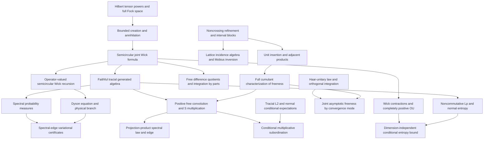

# Mathematical target audit and dependencies

Targets are the concrete theorems in [PROJECT_GOAL.md](PROJECT_GOAL.md). This audit
compares actual existing declarations with those targets. Open entries are
obligations, not assumptions that count as established results.

See [EXECUTION_QUEUE.md](EXECUTION_QUEUE.md) for current isolated worker
assignments, verification checkpoints, design decisions and successive tasks.

## Audit of the eleven goals

| Goal | Existing reusable results | Earliest missing dependencies and remaining target |
| --- | --- | --- |
| 1. Cumulant calculus — complete | All-order freeness iff mixed cumulants vanish; inversion, multilinearity/naturality; unit/scalar/centering and adjacent/interval-product calculus; actual refinement lattice and Möbius inversion; pairings, Catalan counts and interval blocks; greatest Kreweras complement, exact block counts/raw connectivity; actual alternating moments and boxed product cumulants | Certified after PR #1 merge and full main checks at `76af384`. Rotation/closed-form μ are optional; analytic S multiplication belongs to Goal 7 |
| 2. Fock semicircular systems | Actual complete full-Fock package for arbitrary complete complex Hilbert spaces, original-H completed tensor recursion, bounded all-vector creation/adjoints and literal tensor action; complete grading; actual canonical free semicircular word model with faithful tracial generated C-star state, norm two, joint Wick and Catalan moments | Explicit recursively completed TensorPower Hilbert sum, exact tensor-domain operators, intrinsic faithful tracial generated C-star state and joint Wick/Catalan laws are integrated. Semicircular spectral measure/density and basis-independent invariant interfaces remain |
| 3. Free integration by parts | All-degree actual word IBP; polynomial/joint-distribution interfaces | Actual tensor polynomial derivative with full Leibniz, polynomial and finite-matrix IBP are integrated. Actual single-generator resolvent IBP and Cauchy quadratic on the full resolvent set integrated; general polynomial resolvent, matrix analytic and exponential extensions remain |
| 4. Operator-valued Dyson | `ConditionalExpectation`, bimodule identities, algebraic amalgamated freeness, mixed second moment | Completely positive covariance and operator-valued semicircular realization/Wick recursion; amplified tracial expectation and Dyson proof, physical branch, entrywise comparison |
| 5. Spectral-edge formula | Matrix operator-norm, positivity-order and Hermitian resolvent tools | Faithful semicircular pencil, spectral endpoint and Dyson theory; variational identity, exterior derivative/Lyapunov identities, finite Fock truncation bounds and edge certificates |
| 6. Spectral distributions | Positive continuous states, Cauchy resolvents, geometric moment expansions, half-plane properties, equality and convergence from bounded moments | Actual spectral probability measures, real continuous CFC integral representation and faithfulness implies support–spectrum equality integrated; general complex CFC/all-resolvent Cauchy representation and spectral algebraic power/polynomial law compatibility undergoing integration; exact compact spectral-law equality iff all power moments integrated; weak law and full nonreal transform convergence remain. Existing moment-transform and analytic S-transform implementations should be reused |
| 7. Multiplicative convolution | `sTransform_idempotent_eventually`, `sTransform_zero`, transform scaling and naturality; rational projection-product parameter calculus | Positive free realizations and spectral laws; convolution well-definedness and S-transform product theorem; projection measure, physical branch and support identification. Rational critical points alone prove no spectral edge |
| 8. Conditional subordination | Algebraic conditional expectations and explicit nonzero-mean inverse-transform domain | Tracial noncommutative L² and von Neumann conditional expectation; analytic multiplicative subordination, exterior continuation, enlarged conditioning and annihilating-projection specialization |
| 9. Haar freeness | Orthogonal Haar probability/invariance, low-order moments, spherical/Gaussian laws, concentration and almost-sure array convergence; algebraic joint moments | Abstract Haar-unitary star-law and free conjugation; general orthogonal pairing integration and joint asymptotic estimates. Separate expected, probability, almost-sure and strong convergence interfaces |
| 10. Free Gaussian OU/entropy | General positive expectations; actual polynomial Wick vacuum vectors with `Fock.vacuumExpectation_wick_star_mul` orthogonality | Wick contractions/norm bounds and second quantization; complete positivity and normal OU extension; noncommutative Lᵖ, entropy, data processing, lower semicontinuity and dimension-independent regularization |
| 11. Follow-up foundations | Scalar and algebraic operator-valued probability, cumulants, analytic transform tools | Formal R-additivity and algebraic moment free CLT integrated; concrete variance-one faithful tracial Fock target integrated. Quantitative non-iid moment CLT integrated under explicit cumulant bounds and averaged variance convergence. Positive free products, analytic additive convolution/R identification, operator-valued cumulants, second-order/annular theory and genus expansions remain |

Goal 1 is certified complete at checked main `76af384`; the other ten targets
remain open. Supporting interfaces alone do not certify a target. See
[PROGRESS.md](../PROGRESS.md) for verified declarations and their current scope.

## First development path

Refinement and interval-block combinatorics support noncrossing deletion,
contraction and insertion maps. Those maps support unit insertion and
adjacent-product cumulant identities, then the missing direction of the freeness
characterization. Finite lattice structure and its incidence algebra are needed
for the separate Möbius-inversion goal; recursive inversion is already available
and should not be replaced.

Full Fock space is a separate first-priority path. Establish its Hilbert-space
model and bounded creation operators before claiming semicircular moments,
faithfulness or traciality. The vacuum state on all bounded Fock operators is not
a substitute for its faithful tracial restriction to the semicircular algebra.

[Sources and attribution](SOURCES.md) records dependency provenance. Existing
matrix and ReLU modules are examples and reusable tools, not application targets.
