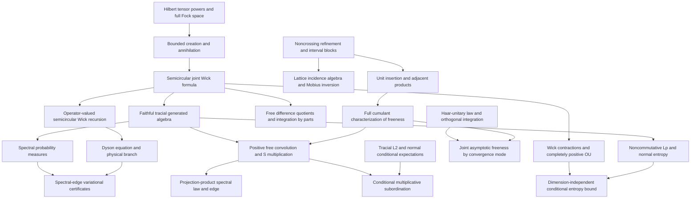

# Mathematical target audit and dependencies

Targets are the concrete theorems in [PROJECT_GOAL.md](PROJECT_GOAL.md). This audit
compares actual existing declarations with those targets. Open entries are
obligations, not assumptions that count as established results.

See [EXECUTION_QUEUE.md](EXECUTION_QUEUE.md) for current isolated worker
assignments, verification checkpoints, design decisions and successive tasks.

## Audit of the eleven goals

| Goal | Existing reusable results | Earliest missing dependencies and remaining target |
| --- | --- | --- |
| 1. Cumulant calculus — complete | All-order freeness iff mixed cumulants vanish; inversion, multilinearity/naturality; unit/scalar/centering and adjacent/interval-product calculus; actual refinement lattice and Möbius inversion; pairings, Catalan counts and interval blocks; greatest Kreweras complement, exact block counts/raw connectivity; actual alternating moments and boxed product cumulants | Certified after PR #1 merge and full main checks at `76af384`. Rotation/closed-form μ are optional; analytic S multiplication belongs to Goal 7 |
| 2. Fock semicircular systems — complete | Complete full F(H) for arbitrary complete complex H and arbitrary ON family without spanning/countability assumptions; original-H literal completed tensor creation/adjoints, scalar vacuum and grading; canonical relations and self-adjoint/centered/variance-one/norm-two fields; actual faithful tracial literal generated C-star state, freeness and joint Wick/Catalan; explicit semicircle density and exact operator spectrum | Certified after PR #5 and full main checks at `68de4fe`. Independently chosen-model unitary coherence integrated at `4c9b9f2` |
| 3. Free integration by parts — complete | All-degree actual word IBP; polynomial/joint-distribution interfaces | Actual tensor polynomial derivative with full Leibniz, polynomial and finite-matrix IBP are integrated. Actual single-generator resolvent IBP and Cauchy quadratic on the full resolvent set integrated; entire scalar/finite-matrix polynomial exponential IBP is integrated at `9715c11`; full polynomial/matrix resolvent IBP on every actual invertibility point and restricted-state transport are integrated at `287bcf7`; full norm-convergent scalar/matrix/closed-state series are integrated at checked main `5706254` with explicit value and derivative bounds and a genuine infinite-series usage; Goal 3 is certified |
| 4. Operator-valued Dyson | Actual matrix conditional expectation, all amplified covariance positivity and scalar-state complete positivity; actual Fock matrix model, ordered joint/interspersed Wick law, tensor FDQ and covariance moment recursion, checked at `a1f942b` | Actual full-domain affine matrix inverse Dyson is integrated at `e7f693e`. Actual strict half-plane sign, normalized analytic physical branch, full right-exterior positivity, derivative and Lyapunov are integrated at `3f6b367`. General arbitrary-base CP-covariance realization and entrywise comparison remain |
| 5. Spectral-edge formula | Actual affine Hermitian matrix pencil, full right spectral-exterior positivity and actual derivative/Lyapunov integrated at `3f6b367`; actual completion-square and exact top-edge variational formula integrated at `06f8254` | Positive-state/density inequalities integrated at `5131911` and actual full-exterior spectral gap order bounds at `95c414c`; quantitative finite Fock truncation bounds, singular edge limits and deterministic edge subspaces remain. General Hermitian coefficients require neither positivity nor commutation |
| 6. Spectral distributions — complete | Actual compact spectral probability measures; real/complex continuous CFC integral representation; faithful support=spectrum; whole-resolvent Cauchy spectral integral; algebraic power/polynomial compatibility and equality iff power moments; bounded moment convergence gives actual weak laws and every pointwise nonreal Cauchy limit; existing moment/local inverse/S-germ APIs | Certified after PR #2 and full main checks at `427f72b`. Norm boundedness is explicit; uniform or derivative convergence is not claimed. S multiplication remains Goal 7 |
| 7. Multiplicative convolution — complete | `sTransform_idempotent_eventually`, `sTransform_zero`, transform scaling and naturality; rational projection-product parameter calculus | Actual projection two-atom measure and matching real-trace S germ integrated at `8d38c42`. Generic closure freeness and actual near-zero inverse membership integrated at `714c2de`, quantitative centered bounds at `1767b48`; actual analytic S multiplication, positive sandwich law and cross-realization marginal-law determination integrated at `c292997`. General arbitrary grouping and continuous closed grouping integrated at `3b5fa1d`; actual finite positive-product and half-projection germs/law uniqueness integrated at `149ec02`; actual local moment equation and positive moment/support criterion integrated at `5920b0a`; positive Picard coefficient convergence integrated at `ba2ea90`; actual analytic Picard/moment germ matching integrated at `6087183`; actual Taylor/radius transfer, sharp greatest law-support point and full physical exterior branch, critical-support connection and faithful actual spectral edge certified after PR38 at checked main `bdd05e2`. Universal realization remains Goal11 |
| 8. Conditional subordination | Algebraic conditional expectations and explicit nonzero-mean inverse-transform domain | Tracial noncommutative L² and von Neumann conditional expectation; analytic multiplicative subordination, exterior continuation, enlarged conditioning and annihilating-projection specialization |
| 9. Haar freeness | Orthogonal Haar probability/invariance, low-order moments, spherical/Gaussian laws, concentration and almost-sure array convergence; algebraic joint moments | Abstract Haar-unitary star-law and free conjugation; general orthogonal pairing integration and joint asymptotic estimates. Separate expected, probability, almost-sure and strong convergence interfaces |
| 10. Free Gaussian OU/entropy | General positive expectations; actual polynomial Wick vacuum vectors with `Fock.vacuumExpectation_wick_star_mul` orthogonality | Actual reverse-overlap Wick multiplication and general homogeneous Haagerup bound integrated at `be0f163`; actual unitary second quantization integrated at `cfcc7a5`; genuine cross-space isometry and all-level CP compression integrated at `741660d`; doubled rotation and actual Wick scaling integrated at `8231e13`, generated-algebra range/embedding and genuine native CP self-map/Wick action and full norm-closure semigroup integrated at `d5c9801`; true state L2 contraction and genuine complete cyclic Hilbert extension integrated at `03aff10`; strong action continuity on native algebra/complete cyclic L2 integrated at `2470d2a`; actual ambient WOT compression/conjugation integrated at `619788f`; actual WOT-generated reducing/range/faithfulness/injectivity integrated at `ab1573b`; normal embedding/OU extension; noncommutative Lᵖ, entropy, data processing, lower semicontinuity and dimension-independent regularization |
| 11. Follow-up foundations | Scalar and algebraic operator-valued probability, cumulants, analytic transform tools | Formal R-additivity and algebraic moment free CLT integrated; concrete variance-one faithful tracial Fock target integrated. Quantitative non-iid moment CLT integrated under explicit cumulant bounds and averaged variance convergence. Positive free products, analytic additive convolution/R identification, operator-valued cumulants, second-order/annular theory and genus expansions remain |

Goals 1, 2, 3, 6 and 7 are certified complete at checked main `76af384`, `68de4fe`,
`5706254`, `427f72b` and `bdd05e2`; the other six targets remain open. Supporting interfaces alone do not certify a target. See
[PROGRESS.md](../PROGRESS.md) for verified declarations and their current scope.

## First development path

Refinement and interval-block combinatorics support noncrossing deletion,
contraction and insertion maps. Those maps support unit insertion and
adjacent-product cumulant identities, then the missing direction of the freeness
characterization. Finite lattice structure and its incidence algebra are needed
for the separate Möbius-inversion goal; recursive inversion is already available
and should not be replaced.

Full Fock space is a separate first-priority path. Establish its Hilbert-space
model and bounded creation operators before claiming semicircular moments,
faithfulness or traciality. The vacuum state on all bounded Fock operators is not
a substitute for its faithful tracial restriction to the semicircular algebra.

[Sources and attribution](SOURCES.md) records dependency provenance. Existing
matrix and ReLU modules are examples and reusable tools, not application targets.

### Actual sharp projection-product law edge integration feature

Checked main `73ce833` includes CI Verification coverage (full3745,
Verification3748, direct transitive audit5008 and source guard).
Seven reviewed analytic modules through `3d8a9d9`, with frozen notes `37b2f94`,
are assembled for integration. Actual expectation Taylor coefficients transfer
from the constructed Picard germ, giving true moment summability and support
bounds. Critical scalar supersolutions prove the sharp upper bound for ALL L>=2.
Analytic continuation of the true LAW moment series, its positivity and the
GLOBAL scalar curve maximum prohibit any smaller support bound. Consequently
`StarProbabilitySpace.iteratedHalfProjection_law_support_isGreatest` proves
lambda_L belongs to the actual support and is its greatest point; the right-edge
corollary identifies its supremum. No faithfulness assumption is needed for the
law edge. An actual three-projection usage gives greatest support point 27/32.
`iteratedHalfProjection_realCauchyTransform_eq_momentSum` identifies the actual
law Cauchy integral throughout x>lambda_L, without an ambient resolvent premise.
The separately reviewed physical branch chain through `401d9ff` and notes
`b3a58a5` is published but not yet integrated; Goal7 remains open at this feature.
A owns NEW PhysicalLimits/PhysicalSpectrum modules in its isolated worktree.
B owns NEW SecondQuantizationSuffix modules, with all12 prefix/identification
sources frozen at `0cb842d` pending integration. Reviewer is read-only.
Next independent tasks: integrate the physical branch and faithful spectrum
corollaries; integrate prefix/sector/ALLoperator identification; develop suffix
commutants toward the normal OU extension. No normality claim follows from
bounded-WOT continuity alone; unbounded amplification continuity is false.

Feature checks pass: full lake build3752, Verification3755, direct transitive
axiom audit5089 declarations, source guard/diff. Concrete 27/32 usage compiles.
Its first compilation required qualifying MeasureTheory.Measure; this was a
usage namespace error, not a failure of any mathematical source.
GitHub CI confirmed PR34 run38571454427, PR35 run38572925297 and
PR36 run38573679338 success. Physical and prefix chains critically reviewed
at final published tips; their separate integrations remain queued.

### Actual physical projection branch and faithful spectral edge feature

PR37 sharp actual-law edge merged as `272452cd7a53169da0d30f9bc236fd5b4ad92b14`;
checked main full3752, Verification3755, direct audit5089, integrity/diff and push.
Reviewed physical core through `401d9ff` and frozen notes `b3a58a5` are assembled.
The actual law parameter W=xG(x)-1 is positive throughout x>lambda_L, satisfies
z_L(W)=x, and lies in the proved physical domain. It is the unique root there;
every physical parameter is realized, and the curve image is exactly (lambda_L,infinity).
For L=2 the domain is all positive W; for L>=3 it is 0<W<1/(L-2).
Reviewed `6be9139` identifies the genuine stationary curve value with the actual
support maximum. `aa3739d` proves actual W→0 and xG→1 at infinity.
`7c17f68` proves the L2 curve tends to1 at infinite parameter and the ACTUAL
W(x) tends to infinity as x decreases to1; no finite L2 critical coordinate.
Spectrum wrappers `e75218e` identify the actual ambient spectral maximum under
faithfulness and supply the full sharp exterior operator resolvent; operator and
law Cauchy transforms agree at every actual resolvent point without faithfulness.
The faithful exterior normalized operator parameter is the actual physical W.
Goal7 completion audit is pending the reviewer certificate and integration checks.
Other open targets retain their exact scope; normal OU, entropy and general
operator-valued covariance/subordination/asymptotic foundations remain open.

Physical feature checks pass: full3762, Verification3765, direct transitive audit
5159 declarations, source integrity/diff. Actual length-two unique-root usage
compiles. Reviewer approves all ten physical modules including exact faithful
spectrum scope, and certifies that every literal Goal7 mathematical subtarget
is covered after successful main integration. Convolution is for GIVEN free
positive elements with proved cross-realization law independence; universal
free-product realization remains the independent Goal11 obligation.
Certificate must be recorded only after the merged main checkpoint passes.
A clean isolated worktree now uses `feat/haar-conjugation`, based on checked
main272452c, owning only NEW HaarUnitary/HaarConjugationWords/HaarConjugation
and agreed notes. Next target is entire-algebra integer Haar conjugate freeness.
B continues new suffix amplification/commutant work; frozen prefix integration next.

### Goal7 completion certificate at checked main bdd05e2

Physical branch PR38 merged as `bdd05e233dcac523f886247b984a2680cbf76327`.
Post-merge full lake build3762, Verification3765, direct transitive audit5159,
source integrity/diff and explicit main push pass. PR37 supplies actual law edge.
The read-only reviewer checked every literal Goal7 requirement in PROJECT_GOAL:
actual given-free-positive sandwich convolution with cross-realization marginal
law independence and analytic S multiplication under nonzero means; actual
projection two-atom law and S germ; all finite free half-projection product laws;
actual greatest law-support point lambda_L; full actual physical Cauchy branch,
unique root, exact parameterization/image and critical-to-support connection,
including the L2 infinite-coordinate boundary; faithful actual ambient spectral
edge and full exterior operator resolvent/Cauchy identification.
Goal7 is certified complete at this checked integration. Convolution is for given
free positive elements; universal free-product realization is still Goal11.
Goals 1,2,3,6,7 are complete; goals 4,5,8,9,10,11 remain open.
Next independent tasks are the published complete prefix representation/sector
integration, new suffix commutant prerequisites for normal OU, and abstract
Haar-unitary entire-algebra integer conjugation freeness. No unfinished goal is
certified by the presence of files alone.

### Complete prefix representation and actual Gamma bridge integration feature

Goal7 certificate PR39 merged at `b22509301b70a3923b509a99c65e06410ec4e530`;
checked main full3762, Verification3765, direct audit5159, guard/diff and push.
Twelve reviewed prefix modules and two frozen design notes through `0cb842d`
are assembled. Ordered first-outside-letter splitting gives a complete Hilbert
prefix/tail unitary; true coordinatewise amplification acts on ALL infinite
Hilbert vectors and ALL bounded source operators. Its WOT continuity is proved
on every norm ball, without claiming false global unbounded-net continuity.
Arbitrary isometry transport preserves every creation/annihilation operator;
the native ON-family restriction equals the previously constructed embedding.
Actual Gamma(V) is exactly the complete empty-tail sector, giving ALL-source-
operator intertwining, actual compression left inverse and vacuum-state identity.
No spanning/countability/nontriviality assumption is added to the isometry.
These are not yet a normal generated von Neumann embedding or normal OU result.
Feature full3774, Verification3777, direct transitive audit5452, source/diff pass;
an actual all-operator compression usage compiles. All important statement scopes
were critically reviewed. Root owns NEW PrefixCommutant/PrefixVonNeumann helpers;
B owns NEW suffix operator/commutant modules, with all12 prior sources frozen.
A owns NEW Haar-unitary/conjugation modules in its isolated feature branch.
Reviewer approved a literal doublecommutant prefix-block/suffix-range route that
avoids general Kaplansky for range, plus a bounded finite-rank ALLB semigroup
route. Both still require actual new kernel proofs. Positive order-sup normality
and doublecommutant traciality remain explicit separate obligations.

### Literal double-commutant amplification integration feature

Prefix PR40 merged at `61c259146bf5c5133176c1f44518602085d5d540`;
checked main full3774, Verification3777, direct audit5452, source/diff and push.
Root proofs `4367dae`, `7d23481`, `0b3c7fc` establish complete Hilbert-sum block
commutation and literal doublecentralizer preservation, generic multiplicative
unitary transport, and actual Fock embedding of ANY entire field doublecommutant
into included fields. No ON/countability/spanning restriction or false WOTclosure
identification is introduced. New math notes retain failed coercion approaches,
precise proof and next suffix/positive-sup/trace dependencies.
CI PR37 run38579133371 failed downloading Elan with connection-reset before any
Lean checks; the failed job was rerun. PR38/40 were still running when queried.
Local kernel checks are unaffected; no CI success is claimed for these runs yet.
A Haar core through2ff26dd+notesbe814c9 is reviewed/published pending integration;
A now owns HaarIndependentConjugation. B owns suffix modules/commutants, with
reviewed outside-letter and Gamma identities. Goal statuses unchanged: 1,2,3,6,7
complete; 4,5,8,9,10,11 open. Normality and entropy remain unproved obligations.

Doublecommutant feature checks pass full3776, Verification3779, direct audit5465,
source integrity/diff. Arbitrary-family literal doublecommutant usage compiles.
All new mathematical statements critically reviewed; no new full goal completed.
GitHub CI37 failed-job retry run38579133371 succeeds, confirming the download
failure was transient; CI38 run38579730062 succeeds. CI40 still in progress.

### Actual entire-algebra Haar conjugation integration feature

Literal doublecommutant PR41 merged as `bbdba56fe5665164cac06b2375719c0f0020aa9b`;
checked main full3776, Verification3779, direct audit5465, source/diff and push.
Four reviewed Haar modules and exact notes through `f8cc8f8` are assembled.
`IsHaarUnitary` uses genuine unitary GROUP integer powers; its complete starword
law is proved. `freelyIndependent_haarConjugatedAlgebras` gives ALL integer copies
of the ENTIRE supplied algebra, from original whole-base/whole-Haar freeness.
Exact telescoping of centered alternating words uses adjacent label differences,
allowing nonadjacent repetitions. Joint and joint star distributions are preserved.
`freelyIndependent_independentHaarConjugatedAlgebras` treats an arbitrary indexed
jointly free family of entire Haar algebras and the entire base algebra, including
empty/infinite index sets. None requires trace, positivity or topology.
This completes the abstract Haar-conjugation subtarget only; Goal9 still needs
general orthogonal pairing integration and random asymptotic freeness.
A clean branch `feat/compact-haar-averaging` from checked bbdba56 owns NEW compact
Haar Bochner averaging/projection modules. B continues suffix source-commutator
and rotated-range proofs; root handles integration and remaining independent
prerequisites. All earlier worker source/notes remain frozen.
Reviewer identifies Goal4 arbitrary-CP Gram positivity and ordered nested Wick
recursion as ready independent prerequisites. General CP realization still lacks
correspondence/nullspace completion, interior balanced tensor, adjointable-operator
and full Hilbert-module Fock interfaces. Existing scalar GNS is not that theorem.

Haar feature checks pass full3780, Verification3783, direct transitive audit5549,
source integrity/diff. Entire integer-family usage compiles. All four exact
module statements and declaration collisions critically reviewed.
GitHub CI40 run38580290981 now confirmed success; later CI not yet queried.

### Actual suffix representation and geometric complement integration feature

Haar PR42 merged as `45aae93e6d44510d09d7d4475712c0fb196308c4`;
checked main full3780, Verification3783, direct audit5549, source/diff and push.
Eight reviewed suffix modules and frozen notes through `22b487f` are assembled.
Actual complete linear word reversal, adapted source/target reversals and true
ALL-source-operator suffix embedding give Gamma intertwining, actual full
compression left inverse and ambient vacuum-state preservation. Complete sectors
prove commutation with every outside creator/annihilator and extend via actual
basis expansion to ALL vectors orthogonal to the isometry range.
Included-field commutant transport is currently proved for each chosen source
basis field under its genuine commutation hypothesis. Arbitrary prescribed
individual fields still need the exact creator commutator defect; complex
linearity of the real field map is neither assumed nor claimed. Creator-first
complex-linear extension followed by adjoint and fixed-vector addition is the
reviewed next route. New SuffixDefect modules remain B-exclusive/unintegrated.
A owns actual real compact-group orthogonal Haar averaging/projection, with
infinite complete real Hilbert spaces allowed; no pairing FFT is assumed.
Root next owns arbitrary CP-covariance finite Gram and quadratic positivity,
a genuinely independent Goal4 prerequisite rather than general realization.
Goal statuses remain five complete/six open. Normal OU, full orthogonal pairing
integration/asymptotic freeness and general covariance realization remain open.

Suffix feature checks pass full3788, Verification3791, direct transitive audit5655,
source integrity/diff. Genuine all-operator suffix compression usage compiles.
All eight module statements and collision scopes critically reviewed at the
published final tips; no normality or arbitrary-field claim is introduced.

### Arbitrary CP covariance Gram positivity integration feature

Suffix PR43 merged as `96193a7ac5c7316c62adf98cd543c25cea6241a4`;
checked main full3788, Verification3791, direct audit5655, source/diff and push.
Root reviewed/audited `aace45c` proves actual finite C-star Gram positivity,
CP covariance mapped-Gram positivity and fully ordered coefficient quadratic
positivity for EVERY finite type including empty. Covariance needs neither
unitality nor a finite Kraus representation; no trace/faithfulness assumption.
An actual positive-cone induction preserves all noncommutative factor order.
This is a proven Goal4 prerequisite; general covariance realization remains open.
New design notes record the failed CFC-instance approach and the verified cone
proof, plus exact correspondence/tensor/adjointable-operator obligations.
A actual compact real Haar projection through34dcc10 is reviewed/published
pending integration and continues actual orthogonal tensor representation.
B exact basis creator defect9fd86f9 is published; arbitrary-h defect stillactive.
Five goals remain complete and six open; no new full goal is certified here.

Covariance feature checks pass full3789, Verification3792, direct audit5661,
source integrity/diff. Actual three-coefficient nonunital-covariance usage compiles.
All six public declarations critically reviewed and collision-free.
CI39 run38579919914, CI41 run38582089296, CI42 run38582719980 and
CI43 run38583117617 confirmed success. All queried CI through PR43 pass.

### Actual compact Haar projection and orthogonal tensor coefficients feature

CP covariance PR44 merged as `cb517b9b37493f3f00aa34775a360c4b87bde36d`;
checked main full3789, Verification3792, direct audit5661, source/diff and push.
Reviewed actual compact Haar averaging/projection through `eb16668` and exact
notes `34dcc10` are assembled. For genuine continuous isometric representations
on complete REAL Hilbert spaces, including infinite spaces, actual normalized
Haar Bochner averaging is norm contraction, selfadjoint and idempotent, with
range exactly fixed vectors and kernel exactly their orthogonal complement.
No assumed invariant projection or complex averaging extension is substituted.
Reviewed `2196e3f` and notes `5a2f0e8` construct the ACTUAL orthogonal tensor
representation on every finite tuple degree; true monoid/orthogonality/continuity
are proved. Its actual averaging coefficients are the genuine entryMoment
integrals. Degree zero and empty dimensions are included without false size
assumptions. Invariant-tensor pairing spanning/FFT/Weingarten and random-matrix
asymptotic freeness remain unproved Goal9 obligations.
A now owns NEW OrthogonalPairingInvariant, constructing invariant tensors for
ALL perfect pairings (crossings included), without a spanning assumption.
B all-vector creator defect39a6281 is published and reviewed separately;
adjoint/field commutant and rotated doublecommutant compression range are active.
Next root tasks include genuine doublecommutant faith/trace and directed-positive
sup normality prerequisites; Cstar-native OU does not certify Goal10 normality.
Five full goals complete and six open; no new full goal completed by this feature.

Compact/tensor feature checks pass full3792, Verification3795, direct audit5744,
source integrity/diff. Actual degree-four Haar-projection coefficient usage compiles.
All three modules and exact real/degenerate-dimension scopes critically reviewed;
no FFT or new full-goal completion is claimed.

### Actual Fock von Neumann vacuum checkpoint

PR45 is checked main `9148022d6f19f95820ca57bcf5b4f81a0cc4d122`: full3792,
Verification3795, direct transitive5744, integrity/diff and push pass. CI44
38584228682 and CI45 38584939394 are confirmed successful.
Root source commits c6942e9, d16719b, 5ec2477, 5aa789b, corrected86ae568
and29330f8 construct literal word and actual tensor-family double-commutant
von Neumann algebras with closed Cstar carriers. Entire word algebra vacuum is
faithful and tracial; actual tensor-family vacuum is faithful and tracial for
EVERY orthonormal family, without spanning, countability or nonempty assumptions.
Major declarations: wordSemicircularVonNeumannAlgebra_vacuum_faithful/tracial,
tensorFamilyVonNeumannVacuumState_faithful/tracial. Trace uses actual anti-linear
word conjugation and right Wick commutation, not an assumed weak density theorem.
An initial feature snapshot repeated existing star_creationWord;86ae568 removed
it and imported the existing theorem. Corrected whole-library audit passes.
Reviewer approved precise statements and all five new transport declaration names.

Published independent checkpoints awaiting integration: A df43a3e has actual
stable orthogonal FFT/Weingarten formula for N>=r and literal normalized inverse
leading limits; low N and joint random-matrix convergence remain open. B4e47415
has actual double-commutant OU range, intrinsic unital CP contraction/time-zero,
and WOT continuity on uniform norm balls. Normality and whole-algebra time
composition are not claimed. A exclusively owns new OrthogonalWeingartenBounds;
B exclusively owns new OrnsteinUhlenbeckVonNeumannVacuum modules. Next: prove
all-vector rotation sandwich equals degree damping and use faithful vacuum to
establish time composition on ON-family algebras, then directed positive sup
preservation/normality. Full goals4,5,8,9,10,11 remain open.

Feature integration checks: full3797, Verification3800, transitive5857, source
integrity and diff pass. New ON-family whole-algebra faith/trace focused build
and individual standard-axiom audits pass; no new full goal is certified.

### Literal OU double-commutant range integration

PR46 checked main `da78dfa1b1e5f7770f13a9fce05045bfe738633f` passes full3797,
Verification3800, transitive5857, source/diff and push. Actual ON-family faithful
tracial whole-algebra vacuum is now integrated, not merely a feature result.
Reviewed B suffix defect chain9fd86f9..7938b23 and range chainb4dd72f..5143895
with exact notesb21b90c/40b7334 are assembled here: unconditional all-vector
creator/annihilator/field defects, specified-family suffix commutation, literal
rotated double-centralizer compression range, genuine all-matrix CP, unital
norm contraction, vacuum preservation, nonnegative time specialization and
time zero for every bounded operator. Actual WOT continuity is asserted on
each uniform operator-norm ball; no unrestricted WOT continuity is claimed.
Main declarations: ouDoubleCommutantRaw_mem_familyDoubleCentralizer,
ouDoubleCommutantRawCP_mem_familyDoubleCentralizer,
ouDoubleCommutantTimeCP_zero and_boundedWOT_continuous.
No ON assumption is needed for range in the prescribed-field algebra.
Whole-algebra composition and directed positive sup normality remain separate.
B published all-vector vacuum damping05cdeaf, awaiting review/integration, and
is proving ON-family whole-algebra composition using the checked faithful
vacuum. A406b97a has actual eventual uniform O(1/N) rescaled Weingarten entry
error, awaiting integration. All goals statuses remain five complete/six open.

Range feature checks pass: full3808, Verification3811, directtransitive5983,
source integrity/diff. All eleven source modules reviewed, no new full goal.

### Actual stable orthogonal FFT and entry integration

PR47 checked main `2260d14249be0ed6ce560c85e5009dccf318d086` passes
full3808/Verification3811/transitive5983, source/diff and push.
Reviewed A chainc7a8dc1..e4b842f with exact notes17bd38e is assembled: actual
invariant tensors for ALL ordinary perfect pairings (including crossings),
true Gram as dimension raised to raw Setoid-join quotient loop count, actual
stable independence/Gram inverse, genuine invariant-tensor spanning and full
Haar entry-integration formula for N>=r at degree2r. Spanning follows actual
reflection/permutation/45-degree fresh-color coefficient laws and strong
induction on missing colors; no invariant spanning theorem is assumed.
Major declarations: pairingTensor_inner, ordinaryPairingGram_inverse,
span_pairingTensors_eq_fixedVectors, entryMoment_eq_weingarten_delta_sum.
Degreezero/emptydimension cases are retained. The stable N>=r scope is explicit;
low-dimensional spanning/integration remains a separate open obligation.
A later published literal leading limits and uniform rescaled-entry estimates
are separate integration checkpoints. Random-matrix expected/probability/a.s.
joint asymptotic freeness and strong resolvent convergence remain unproved.
Bbc3c599 has whole-ONfamily OU composition awaiting independent review and
integration. Normality needs actual directed positive IsLUB preservation;
no complete lattice on arbitrary noncommuting operator sets is asserted.
Full goal statuses remain five certified, six open.

Stable FFT/integration feature passes full3817, Verification3820, direct
transitive6065, source/diff and independent mathematical review.

### Actual whole-von-Neumann OU semigroup feature

PR48 checked main `914cb5e9a768b82d4229db2c568b879c74474e0b` passes full3817,
Verification3820, directtransitive6065, source/diff and push. Actual stable FFT
and Haar integration are integrated, with low-dimensional scope still open.
Reviewed B chain6bd59b3..687195a assembles genuine finite-rank norm-bounded
WOT approximations to EVERY bounded operator; actual intrinsic unital CP
contractions on every prescribed-family D_e; exact bounded-WOT continuity;
ALLcompleted-vector rotation sandwich=degree damping; actual ANYbounded-T
vacuum identity; and WHOLEONfamily D_e semigroup law with timezero.
The semigroup uses only degreeDamping_add and genuine faithful vacuum separation,
not weak polynomial density or an all-B(H) semigroup assertion.
Major declarations: ouVacuumSandwich_eq_degreeDamping, ouVonNeumannTimeCP_add,
ouVonNeumannTimeContinuous_add, ouVonNeumannTimeCP_state_L2_le,
ouVonNeumannTimeCP_vacuum_strong_continuous. Actual state L2 contraction and
strong time continuity of every vacuum image hold ANYfamily; ON gives injective
faithful state interpretation. No nonspanning cyclic space=ambient identification.
Normality still requires actual bounded positive directed-net IsLUB preservation.
Next root prerequisite positive operator energy and strong monotone convergence;
B newbranchsymmetry owns NEW VacuumSymmetry modules. A owns NEW genuine raw
pairing distance triangle. All eleven integrated-source statements reviewed;
no full Goal10 or random-matrix asymptotic freeness completion is claimed.

Whole-von-Neumann semigroup feature passes full3828, Verification3831,
direct transitive6256, source/diff, precise mathematical review and named audits.

### Genuine bounded monotone operator convergence and directed suprema

PR49 checked main `a123904ee26ab288fb0905095f1169824425abd9` passes full3828,
Verification3831, directtransitive6256, source/diff and push. Whole ON-family
OU semigroup is integrated; normality is still distinct. CI46 38593822819
andCI47 38594314691 are confirmed successful; CI48/49 were still running.
Root commits b913d8e,1aa51db,570e38d,728897a,6dc696e prove actual positive
operator energy, scalar quadratic limits/increment bounds, vector Cauchy and
genuine bounded CLM strong limits for arbitrary normbounded Loewner-monotone
directed nets, actual IsLUB and literal commutant/doublecommutant closure.
The index needs only Preorder plus atTop.NeBot (equivalent to nonempty directed),
not a countable sequence, semilattice or finite-dimensional Hilbert space.
Individual operators need not be positive for monotone convergence/IsLUB;
positivity passes separately under the genuine eventually-positive hypothesis.
No blanket complete lattice on arbitrary noncommuting operator sets is installed.
Major declarations: positiveOperator_energy_le, monotoneOperator_vector_cauchy,
positiveOperator_nonneg_of_strong_tendsto, monotoneOperator_exists_isLUB and
operatorDoubleCentralizer_exists_isLUB. All thirteen public statements reviewed
and individually standard-axiom audited; focused builds are warning-free.
Next normality proof must identify intrinsic DC IsLUB with the constructed
ambient strong supremum, apply bounded-WOT continuity, and identify the image
strong supremum. Intrinsic-to-ambient supremum equivalence is not assumed.
A frozen published checkpoints include true leading/distance Weingarten bounds
and actual complex trace contractions6349c65; new TraceContractions active.
B frozen663f2f8 has true weighted number-operator domain, density, full adjoint
graph and closed graph; new NumberResolvent active. These are not integrated
yet. Five full goals complete, six open; no normality/entropy/freeness completion.

Monotone-limit feature passes full3833, Verification3836, directtransitive6270,
source/diff, all focused builds and mathematical statement reviews.

### Actual OU normality in the directed-positive-supremum sense

PR50 checked main `f502be11e46b15e19eebc46ed02a4444f08e8038` passes full3833,
Verification3836, directtransitive6270, source/diff and push. Genuine arbitrary
bounded monotone operator convergence/actual DC suprema are integrated.
CI48 38594675047, CI49 38595244923 andCI50 38597812853 confirmed success.
Root7615cbe/8ef8aa0 prove generic monotone norm-contraction bounded-WOT
continuity preserves actual directed operator IsLUB, and actual OU normality
for EVERY prescribed family. Positive nets get their norm bound automatically
from their supplied supremum: no extra uniform-bound, ON, spanning, trace or
faith hypothesis remains in ouVonNeumannCP_isLUB/TimeCP_isLUB.
Canonical Cstar order is proved exactly equal to inherited ambient Loewner
subtype order (tensorFamilyDoubleAlgebra_order_eq_inherited). Local consistent
LE/Preorder/PartialOrder instances avoid competing subtype instance inference.
Explicit CP coe rewrites removed a real elaboration timeout; no proof limit
was increased. The actual intrinsic supremum is identified with the constructed
ambient strong supremum by DC membership and subtype uniqueness; it is not
assumed ambient. Images then have a genuine actual strong supremum identified
via bounded WOT continuity and Hausdorff uniqueness.
All nine generic/actual public statements focused-build and standard-axiom
audited, source/diff passed, precise statements/collision/order bridge reviewed.
Normality means preservation of every increasing positive nonempty directed
net with its actual IsLUB. Unbounded-net global WOT continuity is not asserted.
ON-family time-add semigroup plus this normality is genuine normal OU on the
whole actual von Neumann algebra; L1, regularization and entropy remain open.
A cycle components c27cddd frozen, actual cycle-count new module active;
B actual strong right generator derivative452c87c frozen, reverse domain
characterization active. These feature results still await integration.
All full goals statuses remain five complete/six open.

Actualnormality feature passes full3835, Verification3838, directtransitive6296,
source/diff, focused warning-free new modules and exact mathematical review.

### Actual fixed-order Weingarten leading limits and sharp distance decay

PR51 checked main `62ca93b0c632efc860c3d3bc8881b2014324357c` passes full3835,
Verification3838, directtransitive6296, source/diff and push. True positive
directed-supremum normality of actual OU maps is integrated; Goal10 L1 and
entropy still open. Reviewed A sourcechaind6d807b..46b45bd andnotesb110052
are assembled: genuine loop-count diagonal/offdiagonal, normalized true Gram
and literal inverse limits, actual rescaled Haar entry leading sum with
uniform moving-dimension tuple error, general finite raw-Setoid join-card
triangle, exact pairing distance and true distance-sensitive inverse decay.
N^r G_N^-1 entries tend todelta; eventualuniformrescaledweight error≤2M/N,
actual rescaledentryMoment error≤2M^3/N, and actualrescaledinverseentry≤
(r M^r+2 M^(r+1)) N^-d(p,q), whereM=numberofordinarypairings,
d=r−actualrawjoinloopcount. Degreezero literalrescaledweight=1 evenN0.
The sharperrate uses finite inverse identity R=Σ(k<r)E^k+R E^r and genuine
distance triangle; no infinite Neumann convergence hypothesis is assumed.
All six modules and precise fixed-r/eventual/stable scopes reviewed.
Major declarations: tendsto_rescaledWeingartenWeight,
eventually_rescaled_entryMoment_error_le, pairingDistance_triangle and
eventually_rescaledWeingartenWeight_distance_bound.
No normalized traceword convergence follows merely from entrywise estimates.
A actualcomplextrace, networkfactorization, rawpartner/cycle/count checkpoints
04269e9 awaitintegration; newpermutationnetwork trace active.
B actualfullrightgenerator d6966ae awaitsfinalcalculusreview/integration;
newproper-family wholeD cyclicrange/L2bridge active onbranch9017a0a.
Next root fullhomogeneous ℓ2 Wickextension via LinearMap.extendOfNorm, then
actualpositive-time normconvergent Wick reconstruction and vacuum identification.
Five full goals complete/six open; no asymptotic freeness or entropy completion.

Weingarten-rate feature passes full3841, Verification3844, directtransitive6336,
source/diff and all statement reviews. A reviewed centered multi-trace plan is
persisted in math-notes/haar-centered-trace-plan.md; its O(N^-m)/a.s. claims
remain unproved pending actual paired cycle orientation and operator-norm bounds.

### Actual completed-Fock OU generator and exact domain

PR52 checked main `afebf5d124a58113aab90e211e195e8c233e3013` passes full3841,
Verification3844, directtransitive6336, source/diff and push. Genuine actual
Weingarten leading/distance bounds integrated; trace asymptotic plan unproved.
Reviewed B chaind4cf1e4..990bb91 with exactnotesd6966ae is assembled: full
actual vacuum L2 symmetry/positivehalf-timecorrelation; genuine weighted
number domain (n f_n) inℓ2, densepuregrades, actualunboundedlinearN, symmetry,
positivequadraticform, FULLweakadjointgraph equality and closedgraph; true
positiveboundednorm1 resolvent(N+I)^-1 maps EVERYvector intoEXACTdomain and
is a genuine two-sidedinverse; actual completed-Hilbert right generator=-N
with EXACT domain in both directions and real HasDerivWithinAt onIci0.
The weighted domain is operator domain, not the larger quadratic-form domain.
Scalar error domination by actualsummable ‖Nf_n‖² plus Tannery proves true
Hilbertnorm difference-quotient convergence, not merelycoordinateconvergence.
Reverse direction uses actualcontinuousgradeevaluation and real weightedℓ2
membership forced by a genuine stronglimit. Clampmax(t,0) supplies a correct
real-time totalization; no negative-timebounded semigroup/two-sided derivative
or operatornorm generator assertion is made. ZeroHilbert/degree0 retained.
Major declarations: numberOperator_adjoint_graph_iff, numberResolvent_nonneg,
ouGenerator_graph_iff, ouGenerator_domain_iff, ouGenerator_hasDerivWithinAt_iff.
All fifteen modules critically reviewed and individuallystandard-axiom audited.
B properfamily wholeD cyclicrange/L2/action441360b reviewedpendingintegration;
newactual ON-family ListI Hilbertbasis andunitaryOriginalK↔WordSpaceI active.
A truehalfselection89a4eb6 pendingreview/integration, newpairednetworktransfer
active. Rootnextfullhomogeneousℓ2 Wickextension viaextendOfNorm before
actualnormconvergent positive-time Wickreconstruction.
Five full goals complete, six open; noncommutativeL1/matrixentropy stillopen.

Generator feature passes full3856, Verification3859, directtransitive6458,
source/diff and fifteen source-statement reviews. True Hilbert generator/domain
complete; intrinsic L1 and matrix entropy remain distinct missing results.

## Full homogeneous Wick coefficient extension

Published root453b325/0eb17cf extends actual finite Wick reconstruction to all
complete homogeneous ℓ² coefficients with degree bound n+1, exact vacuum
recovery, injectivity and original normclosed-algebra membership. Arbitrary
alphabets and degree zero are retained. This feature awaits checked integration;
full positive-time reconstruction, L1 and matrix entropy remain obligations.
Latest checked main72035ba (PR53) includes the exact weighted Hilbert generator
and domain. Five full goals are complete; goals4,5,8,9,10,11 remain open.

Wick feature integration checks pass: full3858, Verification3861, direct
transitive6499, source guard/diff and independent exact statement review.
Actual all-coefficient vacuum recovery and closed-algebra membership are verified.

### Genuine centered single-Haar expected trace decay integration feature

PR54 checked main83cd262 passes full3858, Verification3861, transitive6499,
integrity/diff and push. Full homogeneous ℓ² Wick completion is integrated.
CI52 run38601584881 and CI53 run38603832037 confirmed successful.
Reviewed A chain6349c65..4d492a6 with exact notes5d3f9f6 is assembled: true
complex trace-word Haar expansion, actual row/column paired networks, genuine
fixed-free involutions and two-half orbit count, explicit selected orientation,
phase-preserving cycle trace transfer, true Euclidean operator-norm bounds,
centered singleton-cycle cancellation and actual normalized expectation.
For r>0, eventual uniform N threshold depends only on r, and ALL centered
complex deterministic matrix factors satisfy expected trace bound
C_r/N times their actual operator-norm product. Uniformly bounded moving-N
families therefore have expectation tending to zero. C_r is explicit with
M=number of ordinary pairings: M²(rM^r+2M^(r+1)).
Zero degree/dimension identities are retained separately; no false nonempty
centered theorem is applied at r=0. All source statements mathematically
reviewed and focused standard-axiom audited. Variance/probability/a.s. and
multiple independent Haar colors remain distinct unproved Goal9 dependencies.
Worker A now owns NEW multi-trace expansion/bound modules. Worker B owns NEW
native family Cstar image transport. Root next normconvergent Wick series.
Five complete full goals/six open; no full Goal9 certification is claimed.

Centered-trace integration feature passes full3873, Verification3876, direct
transitive6722, integrity/diff and all fifteen module statement reviews.
No new full goal is certified; variance and almost-sure modes remain open.

### Original-family completed cyclic word representation

PR55 checked mainf6bf741 passes full3873, Verification3876, transitive6722,
source/diff and push. Actual centered single-Haar expected trace decay is
integrated; variance and a.s. modes remain open. Reviewed B8d66fb1..63afd3b
and notescc4dbd3 are assembled: actual original closed cyclic space reduces
prescribed fields, whole double-commutant operators preserve it, true dense
vacuum-vector map and faithful/isometric star representation, actual Wick
Hilbert basis and complete WordSpace unitary for EVERY ON family. Complete
coefficients have actual state inner/norm and exact whole-algebra OU length
multiplier. Word representation has exact generators/Wick images and EVERY
represented operator commutes ALL original right fields. No cyclic space=full
ambient, spanning/countability or whole WordVNA surjectivity is assumed.
All nine modules and names reviewed; sourcefocused builds and individual
standard-axiom audits pass. Native normclosed-algebra image equality is the
next worker task, allowing root positive-time reconstruction in original
family algebra. L1 and matrix entropy remain distinct unproved dependencies.
Five full goals complete/six open. Reviewed suffix-Gram route is recorded
separately as an unproved plan, not a mathematical achievement.

Original cyclic representation feature passes full3882, Verification3885,
directtransitive6956, integrity/diff and all nine module statement reviews.
CI54 run38607693716 and CI55 run38608060530 still in progress when queried.

### Genuine positive-time completed Wick and native OU regularization

PR56 checked mainf217432 passes full3882, Verification3885, transitive6956,
source/diff and push. Original-family cyclic representation is integrated.
Reviewed B359200d/0554f84 notes9881bb9 construct exact isometric native
Cstar word equivalence and wholeD native membership detection. Rootf97326e,
e52f41d,384a532,2950c98 prove actual operatornorm full Wick series for EVERY
completedFock f and EVERYcomplex |z|<1, with map bound (1−|z|)^−2, exact
positive-time OU vacuum identity and originalclosedword membership. Genuine
ALLrightcommutation/vacuum separation identifies actual representedPt(T)
with this series, so EVERYwholeONfamilyD T enters the ORIGINALnormclosed
familyCstar at t>0. Actualoperatornorm≤(1−e^-t)^−2‖TΩ‖, independent of
alphabet/ambientdimension. No spanning/countable/nonempty assumption.
Major names: familyWordRepresentation_ou_eq_dampedWick,
ouVonNeumannTimeCP_mem_native, norm_ouVonNeumannTimeCP_le_L2.
Focusednewmoduleswarningfree, directstandardaxiomaudits and exactstatement
reviews pass. NestedCLM norm proof initially hit typeclass/whnf timeout;
explicit codomain and ContinuousLinearMap.opNorm_smul_le fixed inference,
without increasing limits. Scalar L2→operator regularization is proved;
complete matrix entropy, noncommutativeL1 extension/approximation and mixed
degree conditionalentropy remain separate. Reviewedplan persisted as
math-notes/ou-positive-suffix-gram-plan.md. B now owns NEW WickSuffixGram*
finiteactualmatrixdecomposition; candidate positivity is verifiedbutits
OU-image identity remains open. A NEW multi-trace/secondmoment modules have
actualN^-m expectedbounds pendingintegration; variance/a.s. still active.
Five full goals complete, six open; this is not full Goal10 completion.

Full regularization feature passes full3888, Verification3891, directtransitive
7083, integrity/diff and exact six-module reviews. Actual t=log2 factor-four
state-L2 usage compiles. Goal10 L1 and matrix entropy remain open.
