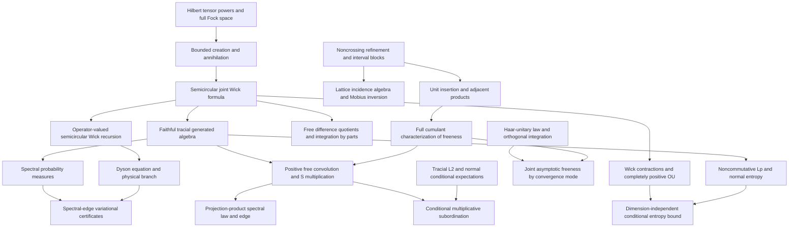

# Mathematical target audit and dependencies

Targets are the concrete theorems in [PROJECT_GOAL.md](PROJECT_GOAL.md). This audit
compares actual existing declarations with those targets. Open entries are
obligations, not assumptions that count as established results.

See [EXECUTION_QUEUE.md](EXECUTION_QUEUE.md) for current isolated worker
assignments, verification checkpoints, design decisions and successive tasks.

## Audit of the eleven goals

| Goal | Existing reusable results | Earliest missing dependencies and remaining target |
| --- | --- | --- |
| 1. Cumulant calculus — complete | All-order freeness iff mixed cumulants vanish; inversion, multilinearity/naturality; unit/scalar/centering and adjacent/interval-product calculus; actual refinement lattice and Möbius inversion; pairings, Catalan counts and interval blocks; greatest Kreweras complement, exact block counts/raw connectivity; actual alternating moments and boxed product cumulants | Certified after PR #1 merge and full main checks at `76af384`. Rotation/closed-form μ are optional; analytic S multiplication belongs to Goal 7 |
| 2. Fock semicircular systems — complete | Complete full F(H) for arbitrary complete complex H and arbitrary ON family without spanning/countability assumptions; original-H literal completed tensor creation/adjoints, scalar vacuum and grading; canonical relations and self-adjoint/centered/variance-one/norm-two fields; actual faithful tracial literal generated C-star state, freeness and joint Wick/Catalan; explicit semicircle density and exact operator spectrum | Certified after PR #5 and full main checks at `68de4fe`. Independently chosen-model unitary coherence integrated at `4c9b9f2` |
| 3. Free integration by parts — complete | All-degree actual word IBP; polynomial/joint-distribution interfaces | Actual tensor polynomial derivative with full Leibniz, polynomial and finite-matrix IBP are integrated. Actual single-generator resolvent IBP and Cauchy quadratic on the full resolvent set integrated; entire scalar/finite-matrix polynomial exponential IBP is integrated at `9715c11`; full polynomial/matrix resolvent IBP on every actual invertibility point and restricted-state transport are integrated at `287bcf7`; full norm-convergent scalar/matrix/closed-state series are integrated at checked main `5706254` with explicit value and derivative bounds and a genuine infinite-series usage; Goal 3 is certified |
| 4. Operator-valued Dyson | Actual matrix conditional expectation, all amplified covariance positivity and scalar-state complete positivity; actual Fock matrix model, ordered joint/interspersed Wick law, tensor FDQ and covariance moment recursion, checked at `a1f942b` | Actual full-domain affine matrix inverse Dyson is integrated at `e7f693e`. Actual strict half-plane sign, normalized analytic physical branch, full right-exterior positivity, derivative and Lyapunov are integrated at `3f6b367`. General arbitrary-base CP-covariance realization and entrywise comparison remain |
| 5. Spectral-edge formula | Actual affine Hermitian matrix pencil, full right spectral-exterior positivity and actual derivative/Lyapunov integrated at `3f6b367`; actual completion-square and exact top-edge variational formula integrated at `06f8254` | Positive-state/density inequalities integrated at `5131911` and actual full-exterior spectral gap order bounds at `95c414c`; quantitative finite Fock truncation bounds, singular edge limits and deterministic edge subspaces remain. General Hermitian coefficients require neither positivity nor commutation |
| 6. Spectral distributions — complete | Actual compact spectral probability measures; real/complex continuous CFC integral representation; faithful support=spectrum; whole-resolvent Cauchy spectral integral; algebraic power/polynomial compatibility and equality iff power moments; bounded moment convergence gives actual weak laws and every pointwise nonreal Cauchy limit; existing moment/local inverse/S-germ APIs | Certified after PR #2 and full main checks at `427f72b`. Norm boundedness is explicit; uniform or derivative convergence is not claimed. S multiplication remains Goal 7 |
| 7. Multiplicative convolution | `sTransform_idempotent_eventually`, `sTransform_zero`, transform scaling and naturality; rational projection-product parameter calculus | Actual projection two-atom measure and matching real-trace S germ integrated at `8d38c42`. Generic closure freeness and actual near-zero inverse membership integrated at `714c2de`, quantitative centered bounds at `1767b48`; actual analytic S multiplication, positive sandwich law and cross-realization marginal-law determination integrated at `c292997`. General arbitrary grouping and continuous closed grouping integrated at `3b5fa1d`; actual finite positive-product and half-projection germs/law uniqueness integrated at `149ec02`; actual local moment equation and positive moment/support criterion reviewed on integration feature; subcritical summability, projection-product physical branch and sharp support identification remain. Rational critical points alone prove no spectral edge |
| 8. Conditional subordination | Algebraic conditional expectations and explicit nonzero-mean inverse-transform domain | Tracial noncommutative L² and von Neumann conditional expectation; analytic multiplicative subordination, exterior continuation, enlarged conditioning and annihilating-projection specialization |
| 9. Haar freeness | Orthogonal Haar probability/invariance, low-order moments, spherical/Gaussian laws, concentration and almost-sure array convergence; algebraic joint moments | Abstract Haar-unitary star-law and free conjugation; general orthogonal pairing integration and joint asymptotic estimates. Separate expected, probability, almost-sure and strong convergence interfaces |
| 10. Free Gaussian OU/entropy | General positive expectations; actual polynomial Wick vacuum vectors with `Fock.vacuumExpectation_wick_star_mul` orthogonality | Actual reverse-overlap Wick multiplication and general homogeneous Haagerup bound integrated at `be0f163`; actual unitary second quantization integrated at `cfcc7a5`; genuine cross-space isometry and all-level CP compression integrated at `741660d`; doubled rotation and actual Wick scaling integrated at `8231e13`, generated-algebra range/embedding and genuine native CP self-map/Wick action and full norm-closure semigroup integrated at `d5c9801`; complete positivity and normal OU extension; noncommutative Lᵖ, entropy, data processing, lower semicontinuity and dimension-independent regularization |
| 11. Follow-up foundations | Scalar and algebraic operator-valued probability, cumulants, analytic transform tools | Formal R-additivity and algebraic moment free CLT integrated; concrete variance-one faithful tracial Fock target integrated. Quantitative non-iid moment CLT integrated under explicit cumulant bounds and averaged variance convergence. Positive free products, analytic additive convolution/R identification, operator-valued cumulants, second-order/annular theory and genus expansions remain |

Goals 1, 2, 3 and 6 are certified complete at checked main `76af384`, `68de4fe`,
`5706254` and `427f72b`; the other seven targets remain open. Supporting interfaces alone do not certify a target. See
[PROGRESS.md](../PROGRESS.md) for verified declarations and their current scope.

## First development path

Refinement and interval-block combinatorics support noncrossing deletion,
contraction and insertion maps. Those maps support unit insertion and
adjacent-product cumulant identities, then the missing direction of the freeness
characterization. Finite lattice structure and its incidence algebra are needed
for the separate Möbius-inversion goal; recursive inversion is already available
and should not be replaced.

Full Fock space is a separate first-priority path. Establish its Hilbert-space
model and bounded creation operators before claiming semicircular moments,
faithfulness or traciality. The vacuum state on all bounded Fock operators is not
a substitute for its faithful tracial restriction to the semicircular algebra.

[Sources and attribution](SOURCES.md) records dependency provenance. Existing
matrix and ReLU modules are examples and reusable tools, not application targets.
